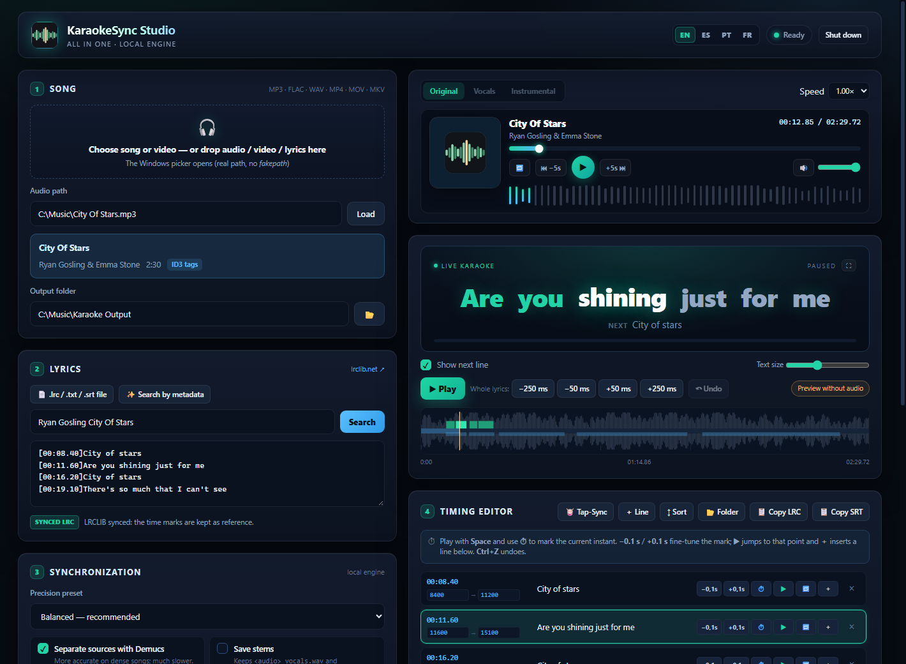

# KaraokeSync

🌐 [English](README.md) | **Español** | [User Guide (EN)](USER_GUIDE.md) | [Guía de uso (ES)](GUIA_DE_USO.md)

<p align="center">
  <a href="https://github.com/svs0z/KaraokeSync/releases/download/v1.4.0/KaraokeSync-1.4.0-win64.zip">
    
  </a>
</p>

<p align="center">
  
</p>

> [!WARNING]
> **Este repositorio contiene la documentación, utilidades complementarias y la aplicación para Windows.**
> El programa listo para abrir —`KaraokeSync.exe`, doble clic y listo— está en
> el botón de arriba o en
> [**Releases**](https://github.com/svs0z/KaraokeSync/releases/latest).
> No requiere Python, ffmpeg ni comandos de consola.

**KaraokeSync te dice exactamente cuándo se canta y qué se canta.**

Analiza una canción o un vídeo completamente en tu ordenador y genera:

1. **Una línea de tiempo al milisegundo** con `VOZ`, `VOZ+INSTRUMENTAL`,
   `INSTRUMENTAL`, `SILENCIO` y `RUIDO`. Demucs `htdemucs` separa el stem vocal
   y un **VAD híbrido de Silero + energía del stem vocal** evita que las notas
   sostenidas, los vibratos y los melismas se corten antes de tiempo.
2. **La letra alineada y vídeo karaoke** cuando la aportas (o auto-subtítulos IA
   desde vídeo): `.lrc`, `.srt`, **`.ass` (barrido `\kf` + cuenta atrás `● ● ●`)**,
   `.json` y **vídeo `.mp4` karaoke (`16:9` / `9:16`)**. La alineación usa
   **stable-ts / faster-whisper sobre la pista vocal aislada** (con refinado
   fonético CTC opcional de 20 ms), con ~65 ms de error mediano en la medición
   del proyecto. No transcribe a ciegas, no inventa palabras, no traduce una
   intro larga al idioma equivocado ni repite estribillos.
3. **Un reporte `.txt`** que se abre perfectamente en el Bloc de notas, con todas
   las advertencias y todos los tiempos.

## Por qué KaraokeSync frente a CapCut Pro / subtítulos automáticos ciegos

| | **KaraokeSync** | CapCut Pro / auto-captions ciegos |
|---|---|---|
| Funciona en local | **Sí** | Normalmente nube o cuenta del editor |
| Precio | **Gratis** para uso personal, educativo y de evaluación | Herramientas de subtítulos avanzadas de pago |
| Separación vocal | **Demucs `htdemucs`** antes de analizar | Normalmente sobre la mezcla |
| ¿Inventa palabras? | **No**; avisa y marca estimaciones | El ASR puede alucinar, traducir mal o repetir estribillos |
| Introducciones largas | Instrumental, silencio o ruido | El ASR ciego puede inventar letra o traducciones |
| `.srt` palabra por palabra | **Sí**, para CapCut Free, DaVinci Resolve y Premiere Pro | Solo en algunos flujos de pago |
| `.ass` y vídeo MP4 karaoke | **`.ass` (`\kf` + cuenta atrás `● ● ●`)** y **exportación MP4 `16:9` / `9:16`** | Atado a editores online |
| Letras para reproductores | `.lrc` y **LRC mejorado** (`<mm:ss.xx>`) para MusicBee, Navidrome, Plex, AIMP, foobar2000 | Normalmente solo subtítulos de vídeo |
| Tus datos | Se quedan en tu ordenador | Depende del servicio |

## Cómo se usa en la práctica

1. Abre `KaraokeSync.exe`.
2. Arrastra la canción o el vídeo a la ventana o elígela con el selector de Windows.
3. Pega la letra, carga un `.lrc` / `.txt` / `.srt`, búscala en LRCLIB o déjala vacía para auto-subtítulos IA.
4. Elige el preset de precisión, el refinado fonético CTC opcional y los archivos de salida.
5. Pulsa **⚡ Sincronizar**.
6. Revisa la línea de tiempo: la onda real muestra la amplitud, los bloques verdes son las líneas y la banda cian es la voz detectada. Ajusta en el editor con **Tap-Sync (`T`)** o **bucle por línea (`🔁`)**.
7. Guarda `.lrc`, `.srt`, **`.ass`** y `.json`, exporta un **vídeo karaoke MP4 (`16:9` / `9:16`)**, o pulsa **📋 Copiar LRC** / **📋 Copiar SRT**.

### Lo más útil de Studio

- **Compatibilidad con vídeos (`.mp4`, `.mov`, `.mkv`, `.webm`, `.avi`, `.m4v`)**, **Subtítulos automáticos con IA (sin necesidad de letra)** y **Extraer audio (`.wav`)** + **Separar voz y fondo (`_vocals.wav` / `_no_vocals.wav`)**.
- **Exportación `.ass` karaoke (`\kf` palabra por palabra + cuenta atrás automática `● ● ●`)** tras intros o pausas instrumentales ≥ 3,5–4 s.
- **Exportador de vídeo karaoke MP4 (`16:9` YouTube y `9:16` TikTok/Reels/Shorts)** sobre el vídeo original, carátula difuminada o fondo oscuro, eligiendo audio original, instrumental o solo voz.
- Casillas **SRT palabra por palabra (CapCut / Reels / TikTok)** y **LRC mejorado** (`<mm:ss.xx>`).
- Escenario karaoke en vivo con **resaltado palabra por palabra**, **cuenta atrás `● ● ●`** y **pantalla completa (`F`)**.
- **Forma de onda real** en el reproductor de 56 barras y en la línea de tiempo (junto a la **banda cian de voz detectada** debajo de los bloques verdes).
- **Tap-Sync (`T`)**, **bucle por línea (`🔁`)**, resaltado de baja confianza y **refinado fonético CTC opcional de 20 ms**.
- **Drag & Drop real** de audio, vídeo y letra sobre la ventana.
- **📋 Copiar LRC** / **📋 Copiar SRT** al portapapeles.
- Cuatro idiomas: English, Español, Português y Français.

## Validador abierto de subtítulos (`tools/validate_subtitles.py`)

Este escaparate público incluye una utilidad Python independiente sin dependencias externas ([`tools/validate_subtitles.py`](tools/validate_subtitles.py)) para validar la sintaxis, monotonicidad y etiquetas `\kf` de tus archivos `.lrc`, `.srt` y `.ass`:

```bash
python tools/validate_subtitles.py cancion.lrc cancion.srt cancion.ass
```

## Requisitos

- Windows 10 u 11, 64 bits.
- Unos 1,4 GB de disco después de extraer.
- Internet solo la primera vez, para descargar los modelos. Después funciona sin
  conexión.
- No hace falta Python, ni ffmpeg, ni permisos de administrador para usar `KaraokeSync.exe`.

## Instalación

1. Descarga `KaraokeSync-1.4.0-win64.zip` desde Releases.
2. Extráelo en una carpeta.
3. Haz doble clic en `KaraokeSync.exe`.

La primera canción tarda unos minutos (descarga de modelos y Demucs). Repetir la
misma canción tarda segundos gracias a la caché.

## Precisión medida

- Mecánica del pipeline contra verdad sintética exacta: **±50 ms**, y el único
  desvío es exactamente el padding configurado.
- Concordancia con la implementación oficial de Silero sobre música real:
  **0,13 s en 45 s** (0,3 %).
- Alineación real de letra en la medición del proyecto: **~65 ms de error
  mediano**, con una línea de un estribillo repetido a 12,7 s. Ningún alineador
  automático es perfecto; por eso KaraokeSync incluye editor visual y nunca
  oculta los resultados dudosos.

## Documentación

- [Guía de uso completa (Español)](GUIA_DE_USO.md)
- [Read this README in English](README.md)
- [Complete user guide (English)](USER_GUIDE.md)

## Licencia

**Software propietario — todos los derechos reservados.** Se permite el uso
personal, educativo y de evaluación. No se permite el uso comercial, la venta, la
redistribución ni publicar una versión modificada como propia. Consulta
`LICENSE` en el paquete o repositorio.
