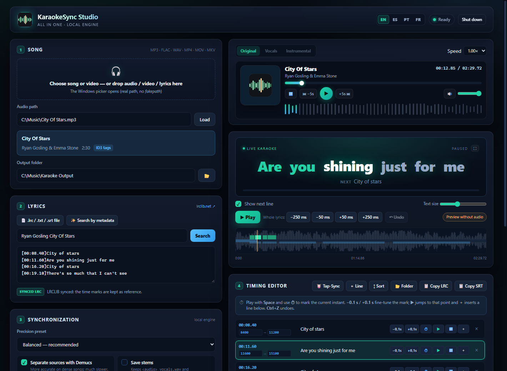

# KaraokeSync

🌐 **English** | [Español](README.es.md) | [User Guide (EN)](USER_GUIDE.md) | [Guía de uso (ES)](GUIA_DE_USO.md)

<p align="center">
  <a href="https://github.com/svs0z/KaraokeSync/releases/download/v1.4.0/KaraokeSync-1.4.0-win64.zip">
    
  </a>
</p>

<p align="center">
  
</p>

> [!WARNING]
> **This repository contains the documentation, companion utilities, and the Windows application.**
> The ready-to-run program —`KaraokeSync.exe`, double-click and go— is in the
> button above or in
> [**Releases**](https://github.com/svs0z/KaraokeSync/releases/latest).
> It does not require Python, ffmpeg or command-line tools.

**KaraokeSync tells you exactly when someone sings and what they sing.**

It analyzes a song or video completely on your computer and produces:

1. **A millisecond-accurate timeline** of `VOZ` (Vocals),
   `VOZ+INSTRUMENTAL` (Vocals + Music), `INSTRUMENTAL`, `SILENCIO` (Silence) and
   `RUIDO` (Noise). Demucs `htdemucs` separates the vocal stem, and a **hybrid
   Silero Neural VAD + vocal-stem energy** detector keeps sustained notes,
   vibratos and melismas from being cut off early.
2. **Aligned lyrics & karaoke media** when you provide lyrics (or local AI
   auto-subtitles from video): `.lrc`, `.srt`, **`.ass` (`\kf` sweep + `● ● ●`
   countdown)**, `.json`, and ready-to-share **`.mp4` karaoke video (`16:9` /
   `9:16`)**. The alignment uses **stable-ts / faster-whisper forced
   alignment** on the isolated vocal track (with optional 20 ms phonetic CTC
   refinement), with ~65 ms median error in the measured run. It does not
   blindly transcribe, invent words, translate a long intro into the wrong
   language or loop choruses.
3. **A `.txt` report** that opens perfectly in Notepad, with every warning and
   every timing.

## Why KaraokeSync vs. CapCut Pro / Blind Auto-Captions

| | **KaraokeSync** | CapCut Pro / blind auto-captions |
|---|---|---|
| Runs completely locally | **Yes** | Usually cloud or editor-account based |
| Price | **Free** for personal, educational and evaluation use | Subscription/paid advanced caption tools |
| Vocal separation | **Demucs `htdemucs`** before analysis | Usually works on the mixed track |
| Invents words? | **No**; it warns and marks estimates | ASR can hallucinate, translate the wrong language or loop |
| Long intros | Classified as instrumental, silence or noise | Blind ASR may invent lyrics or translations |
| Word-by-word `.srt` | **Yes**, for CapCut Free, DaVinci Resolve and Premiere Pro | Some paid workflows only |
| `.ass` & MP4 video export | **`.ass` (`\kf` + `● ● ●` countdown)** & **`16:9` / `9:16` MP4 export** | Tied to online editor export |
| Music-player lyrics | `.lrc` and **Enhanced LRC** (`<mm:ss.xx>`) for MusicBee, Navidrome, Plex, AIMP, foobar2000 | Usually video captions only |
| Your data | Stays on your computer | Depends on the service |

## How it works in practice

1. Open `KaraokeSync.exe`.
2. Drag the song or video onto the window or choose it with the Windows picker.
3. Paste the lyrics, load an `.lrc` / `.txt` / `.srt`, search LRCLIB, or leave lyrics empty for AI video auto-subtitles.
4. Choose the precision preset, optional 20 ms CTC refinement, and the outputs.
5. Press **⚡ Synchronize**.
6. Review the timeline: the real waveform shows audio amplitude, green blocks are lyric lines, the cyan band is detected singing. Fine-tune in the editor with **Tap-Sync (`T`)** or **per-line loop (`🔁`)**.
7. Save `.lrc`, `.srt`, **`.ass`**, `.json`, render a **`16:9` / `9:16` MP4** karaoke video, or press **📋 Copy LRC** / **📋 Copy SRT**.

### Studio highlights

- **Video compatibility (`.mp4`, `.mov`, `.mkv`, `.webm`, `.avi`, `.m4v`)**, **Auto-subtitles with AI (no lyrics needed)**, and **Extract audio (`.wav`)** + **Separate vocals & background (`_vocals.wav` / `_no_vocals.wav`)**.
- **`.ass` Karaoke export (`\kf` progressive sweep + automatic `● ● ●` countdown)** after intros or instrumental gaps ≥ 3.5–4 s.
- **MP4 Karaoke Video Export (`16:9` YouTube & `9:16` TikTok/Reels/Shorts)** with original video, blurred cover art, or dark background, plus original/instrumental/vocals track selection.
- **Word-by-word SRT (CapCut / Reels / TikTok)** and **Enhanced LRC** (`<mm:ss.xx>`) checkboxes.
- **Live karaoke stage** with **word-by-word highlighting**, **`● ● ●` countdown**, and **Fullscreen (`F`)**.
- **Real audio waveform** in both the 56-bar player and the interactive timeline (paired with the **cyan VAD vocal band** under green lyric blocks).
- **Tap-Sync (`T`)**, **per-line loop (`🔁`)**, low-confidence line highlighting, and optional **20 ms CTC phonetic refinement**.
- **Real drag & drop** of audio, video and lyrics over the window.
- **📋 Copy LRC** / **📋 Copy SRT** to the clipboard.
- Four interface languages: English, Español, Português and Français.

## Companion open-source subtitle validator (`tools/validate_subtitles.py`)

This public showcase includes a standalone zero-dependency Python utility [`tools/validate_subtitles.py`](tools/validate_subtitles.py) to validate `.lrc`, `.srt`, and `.ass` timing monotonicity, syntax, and karaoke `\kf` tags offline:

```bash
python tools/validate_subtitles.py song.lrc song.srt song.ass
```

## Requirements

- Windows 10 or 11, 64-bit.
- About 1.4 GB of disk space after extraction.
- Internet only the first time, to download models. Afterwards it works offline.
- No Python, ffmpeg or administrator permissions required for `KaraokeSync.exe`.

## Installation

1. Download `KaraokeSync-1.4.0-win64.zip` from Releases.
2. Extract it to a folder.
3. Double-click `KaraokeSync.exe`.

The first song takes a few minutes (models download and Demucs runs). Repeating
the same song takes seconds thanks to the cache.

## Measured accuracy

- Pipeline mechanics against exact synthetic ground truth: **±50 ms**, and the
  only deviation is exactly the configured padding.
- Agreement with the official Silero implementation on real music: **0.13 s in
  45 s** (0.3 %).
- Real lyric alignment in the project run: **~65 ms median error**, with one
  repeated-chorus line at 12.7 s. No automatic aligner is perfect, which is why
  KaraokeSync includes a visual editor and never hides uncertain results.

## Documentation

- [Complete user guide (English)](USER_GUIDE.md)
- [Read this README in Spanish](README.es.md)
- [Guía de uso completa (Español)](GUIA_DE_USO.md)

## License

**Proprietary software — all rights reserved.** Personal, educational and
evaluation use is allowed. Commercial use, sale, redistribution or publishing a
modified version as your own is not. See `LICENSE` in the package/repository.
