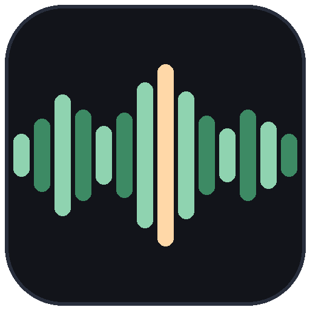

# KaraokeSync

<p align="center"></p>

<p align="center">
  <a href="https://github.com/svs0z/KaraokeSync/releases/download/v1.0.0/KaraokeSync-1.0.0-win64.zip">
    
  </a>
</p>

> [!WARNING]
> **Este repositorio no contiene el programa.** El botón verde *Code → Download
> ZIP* descarga solo esta documentación. El programa —doble clic y listo, sin
> instalar nada— está **en el botón de arriba**, o en
> [**Releases**](https://github.com/svs0z/KaraokeSync/releases/latest).

**KaraokeSync escucha una canción y dice, con precisión de milisegundos, cuándo
se canta y cuándo no**, y sincroniza la letra para karaoke.

## Qué hace

- **Línea de tiempo** de la canción en cinco tipos de tramo: **VOZ**,
  **VOZ+INSTRUMENTAL**, **INSTRUMENTAL**, **SILENCIO** y **RUIDO**, con las marcas
  de tiempo al milisegundo.
- **Sincronización de letra** a partir de un `.txt`, `.lrc` o `.srt`: palabra por
  palabra o línea por línea, con avisos honestos cuando los tiempos no son de
  fiar.
- **Editor de tiempos** en el navegador, incluido: arrastra los bloques sobre la
  barra, mira la letra grande como en un karaoke, oye una sola línea para
  comprobarla, y añade o quita líneas con un clic.
- **Exporta** `.lrc`, `.srt` y `.json`, y un **reporte `.txt`** que se abre
  perfectamente en el Bloc de notas.
- **Funciona sin conexión** después del primer uso, y sin tarjeta gráfica.

## Cómo se usa

1. **Descarga** el paquete del botón de arriba
   (`KaraokeSync-1.0.0-win64.zip`, unos 559 MB).
2. **Descomprímelo** donde quieras (clic derecho → *Extraer todo…*).
3. **Doble clic en `KaraokeSync.exe`**.
4. Elige la canción, y la letra si la tienes, y pulsa **Generar reporte**.

La carpeta queda así:

```
KaraokeSync\
├── KaraokeSync.exe        <- doble clic aquí
└── _internal\             <- todo lo que necesita (no tocar)
```

La **primera canción tarda 4-5 minutos**: descarga los modelos (unos 220 MB) y
separa la voz. Las siguientes tardan segundos.

> **Aviso del antivirus.** El `.exe` no está firmado digitalmente (firmar cuesta
> dinero) y Windows puede pedir confirmación la primera vez: *Más información →
> Ejecutar de todas formas*, o añade la carpeta a las exclusiones.

## Qué necesitas

| | |
|---|---|
| **Sistema** | Windows 10 u 11, de 64 bits |
| **Memoria** | Unos 4 GB libres |
| **Disco** | 2 GB para el programa y los modelos |
| **Sonido** | Cualquier formato habitual (`.flac`, `.mp3`, `.m4a`, `.wav`, `.ogg`) |
| **GPU** | No hace falta; con tarjeta NVIDIA va más rápido |
| **Conocimientos** | Ninguno |

## La guía

Todo el detalle —cómo preparar la letra, qué significa cada aviso del reporte,
qué hacer con los archivos, errores típicos— está en
[**GUIA_DE_USO.md**](GUIA_DE_USO.md).

## Licencia

Software **propietario** de **Sara Valentina Sepúlveda Ortiz (svs0z)**. Se
permite el uso personal, educativo o de evaluación. **No** se permite venderlo,
redistribuirlo ni usarlo comercialmente. El texto completo está en
[**LICENSE**](LICENSE).

Las letras y las grabaciones no se incluyen ni se distribuyen: cada obra tiene
su autor y sus derechos.

## Contacto

- GitHub: [@svs0z](https://github.com/svs0z)
- Incidencias y sugerencias: [Issues](https://github.com/svs0z/KaraokeSync/issues)
